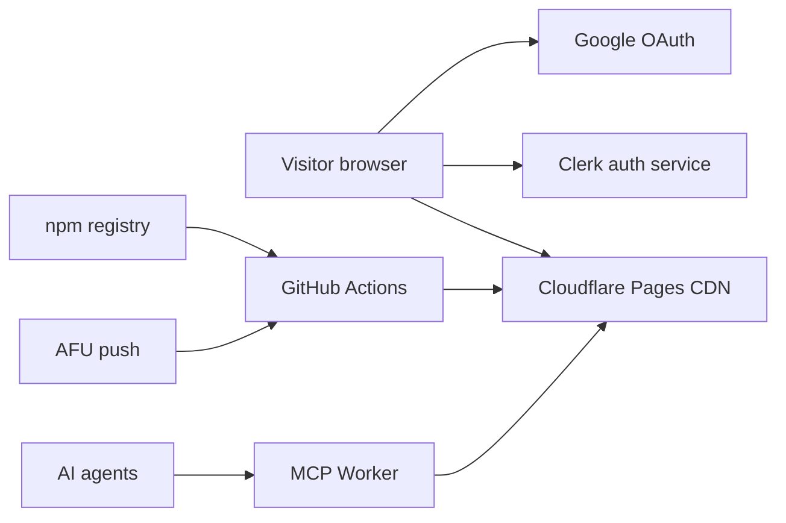

# Security — ownership map + threat model (spec 13)

_Assessed 2026-07-03. Re-check when: a collaborator is invited, a dependency with
install scripts is added, auth changes, or a server/backend is introduced._

## Ownership map

### What we own (and can fix in this repo/accounts)

| Asset | Where | Notes |
|---|---|---|
| Source + content data | github.com/afu-it/mpg (PRIVATE) | 63 gateway `.md` files = the product; single author (bus factor 1, confirmed by git-graph run 2026-07-03) |
| Build + deploy pipeline | Cloudflare Pages Git integration (project `mpg-site`) | Since 2026-07-17: Cloudflare builds on push; NO GitHub Actions deploy, NO secrets in GitHub (TM-001 closed) |
| Response headers | `public/_headers` | HSTS/XFO/nosniff/Referrer/Permissions live; CSP ENFORCING since 2026-07-17 (Report-Only 2026-07-03 → clean smoke → flipped) |
| MCP Worker | `mcp/` → mpg-mcp.afuitdev.workers.dev | Read-only tools, zod-validated, no secrets; deployed manually by AFU |
| DNS zone + Pages project | Cloudflare account | Also holds the deploy API token's blast radius |
| Domain registration | YeahHost (malaysiapg.com.my) | Registrar account = DNS root of trust until NS change |
| GSC property, Google OAuth app | AFU's Google account | OAuth client secret lives in Clerk dashboard |

### What third parties own (we only configure)

| Party | They control | Our exposure |
|---|---|---|
| Clerk | Auth UI/session JS served from clerk.malaysiapg.com.my, session cookies, user store | The ONE runtime script we don't build; loaded `@latest` (no SRI possible) — biggest runtime trust |
| Cloudflare | Pages hosting/CDN, edge headers, Workers runtime, DNS | Adds default `access-control-allow-origin: *` (now detached for HTML); zone settings can override repo intent (managed robots.txt incident 2026-07-03) |
| GitHub | Repo, Actions runners, secrets store | Secrets readable by any workflow run in the repo (see TM-001) |
| Google | OAuth sign-in | OAuth app misconfig/suspension breaks Google sign-in only |
| YeahHost | Registrar | Account takeover = domain takeover |
| npm registry | astro, tailwind, zod, fontsource, @astrojs/* | Build-time supply chain; lockfile + `npm ci` pins |

### Access inventory (2026-07-03)

- Push access: AFU only (no collaborators invited yet). Deploy: AFU only (actor gate).
- GH secrets: NONE (all three deleted 2026-07-17 when deploys moved to Pages Git integration). `PUBLIC_CLERK_PUBLISHABLE_KEY` (public-by-design) lives as a Pages build env var.
- Clerk `sk_*` is used nowhere in the repo or site (client-side auth only). Correction 2026-07-17: local `.env` DOES hold a `CLERK_SECRET_KEY` for `clerk` CLI administration only — gitignored, never committed, never in the build.
- Old Cloudflare deploy API token: pending AFU revocation at dash.cloudflare.com/profile/api-tokens (it also lives in the machine's shell env, not just `.env`).
- 2FA status on GitHub / Cloudflare / Clerk / Google / YeahHost: **unconfirmed — AFU to verify** (highest-leverage single control for this project).

## Threat model

### Executive summary

Static architecture removes most classic attack surface: no server code, no DB, no
session handling of ours, XSS sinks verified clean. The real risks are *around* the
repo, not in it: (1) GitHub Actions secrets exfiltration the moment a collaborator
is invited, (2) AFU account takeover (GitHub/Cloudflare/registrar = full site
control), (3) supply chain (npm at build time, Clerk CDN at runtime), (4) fee-data
integrity (the product IS the data). Visitors' only real exposure is the Clerk
script and any future XSS — hence CSP.

### System model (trust boundaries)

- Visitor → Pages: HTTPS, public content, no cookies of ours. Headers enforced via `_headers`.
- Visitor → Clerk: Clerk JS hotloaded from `clerk.malaysiapg.com.my` (host decoded from pk in `src/scripts/auth.ts`); Clerk owns session cookies.
- URL params → DOM: `?ids=` (compare.ts) and `?category=` (table.ts) allowlisted against known slugs/inputs; choose.ts escapes everything via `esc()`; DOM built with `createElement`/`textContent`; no `innerHTML` with unescaped external data (verified 2026-07-03).
- AI agent → MCP Worker: unauthenticated, read-only, zod-validated, bounded (`limit ≤ 60`); reads only our public JSON API.
- Push → Actions → Pages: owner-gated deploy; secrets available to workflow runs (the boundary TM-001 crosses).

### Assets

| Asset | Why it matters | Objective |
|---|---|---|
| Fee data accuracy | The product's entire value + reputation | Integrity |
| Deploy pipeline + CF token | Controls what the public site serves | Integrity |
| AFU's GitHub/Cloudflare/YeahHost/Clerk/Google accounts | Each = partial or full takeover | All |
| Visitors' browsers | XSS/malicious script = harm to users | Integrity |
| Domain reputation (SEO/AI-answer presence) | Months of SEO work | Availability/Integrity |

### Attacker model

Capabilities: remote unauthenticated web access; crafted links (`?ids=` etc.); MCP/API abuse; npm/action supply-chain compromise; phishing AFU. Non-capabilities: no server of ours to exploit; no privileged multi-user roles; a Clerk *user* account grants nothing but the contribute form unlock (mailto).

### Threats (triaged)

| ID | Threat | Likelihood | Impact | Priority | Status |
|---|---|---|---|---|---|
| TM-001 | Invited collaborator adds/edits a workflow file on any branch → workflow runs with repo secrets → exfiltrates `CLOUDFLARE_API_TOKEN` → deploys arbitrary content / controls Pages. The owner-gate protects the *deploy job*, not *secrets access*. | Low today (zero collaborators) | High | **Medium now, HIGH on first invite** | **CLOSED 2026-07-17 (spec 19)**: deploys moved to Cloudflare Pages direct Git integration; `deploy.yml` deleted; all GH secrets deleted. Residual: revoke the old CF token (AFU, profile page). Repo is now public; contributions arrive via fork+PR with no write access — GitHub never passes secrets (there are none) to fork PRs. |
| TM-002 | AFU account takeover (GitHub/Cloudflare/YeahHost/Clerk/Google) via phishing/reuse | Low-Med | Critical (full site/domain control) | HIGH | **AFU action**: confirm 2FA (ideally passkey/TOTP, not SMS) on all five. Single highest-leverage control. |
| TM-003 | npm supply chain: compromised dep executes at build (locally or in CI) | Low | High | Medium | Mitigated: `npm ci` + lockfile, tiny dep tree (6 prod deps), actions SHA-pinned (2026-07-03). Habit: review lockfile diffs on updates; run `npm audit` at upgrade time. |
| TM-004 | Clerk CDN script compromised/malicious → full-page script control on every page | Very low | High | Medium | **Accepted**: inherent to CDN-hotloaded auth (`@latest`, no SRI). CSP cannot stop a compromised *allowed* origin but blocks its exfil to non-allowed hosts (connect-src). Alternative (self-hosted Clerk JS) rejected: loses instant security patches. |
| TM-005 | Fee-data poisoning via contribution flow (fabricated fees land in the directory) | Low | Medium (reputation) | Low | Mitigated: no write access for applicants (invite-only), sourcing rules on /contribute, owner reviews + owner-gated deploy. TM-001 fix keeps this contained. |
| TM-006 | XSS on the site via URL params or future scripts | Low | High | Medium | Verified clean today (see boundaries). CSP shipped Report-Only 2026-07-03, ENFORCED 2026-07-17 after AFU's clean real-phone + signed-in smoke (regression net active). `'unsafe-inline'` stays (Astro inlines page scripts) so the *load-bearing* directives are connect-src/object-src/base-uri/frame-src. |
| TM-007 | MCP Worker / JSON API quota abuse (cost/availability DoS) | Med (bots exist) | Low (read-only, free-tier, static origin) | Low | **Accepted**: no rate limit, no auth — public data by design. CF observability enabled; add Worker rate limiting only if bills/quotas show abuse. |
| TM-008 | Domain impersonation / typosquat (e.g. .com twin) serving altered fees | Low | Low-Med | Low | Watch only. Brand presence (GSC, schema, backlinks) makes the real domain canonical. |

### Header decisions (scope A closed)

- CSP: **ENFORCING since 2026-07-17** (Report-Only 2026-07-03 → AFU clean smoke → flipped; two weeks of zero console violations). Directive list unchanged; see `public/_headers`.
- `access-control-allow-origin: *`: Cloudflare Pages default; detached site-wide, re-added for `/api/*` only (2026-07-03).
- COOP/COEP/CORP: **not enabled, deliberate.** No cross-origin isolation need (no SharedArrayBuffer), no sensitive cross-origin data to leak-protect, and COOP variants risk breaking Clerk's Google OAuth popup for zero practical gain here.

### Fixed this session (2026-07-03)

- GitHub Actions pinned to commit SHAs (was mutable tags) — `deploy.yml`.
- CSP Report-Only + ACAO scoping — `public/_headers`.

### Open items (AFU)

1. Confirm 2FA on GitHub, Cloudflare, YeahHost, Clerk, Google (TM-002).
2. Rotate the Google OAuth client secret (pending since 2026-07-02) — Google Cloud Console → credentials → rotate; paste new secret into Clerk dashboard.
3. DONE 2026-07-17: smoke was clean → CSP flipped to enforcing. One-time re-check after the enforcing deploy: sign in once on live with console open.
4. Before inviting any collaborator: execute the TM-001 mitigation.
