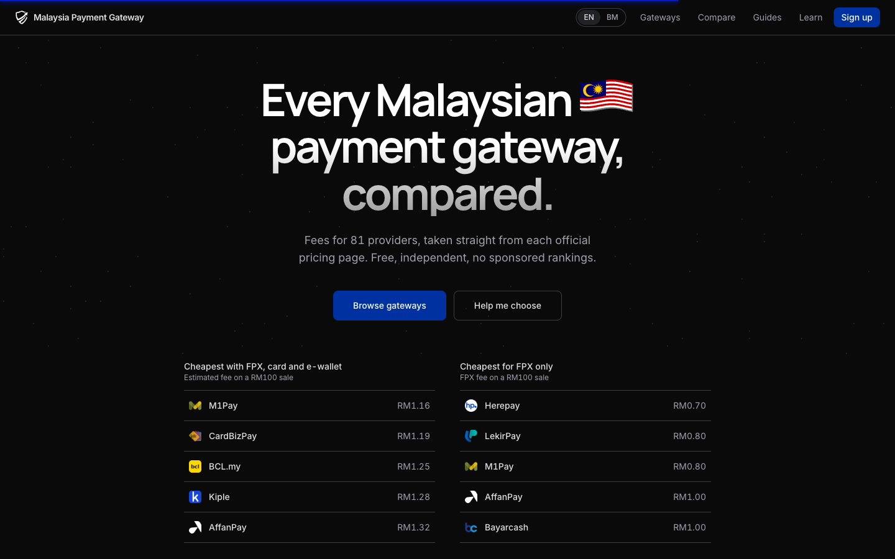
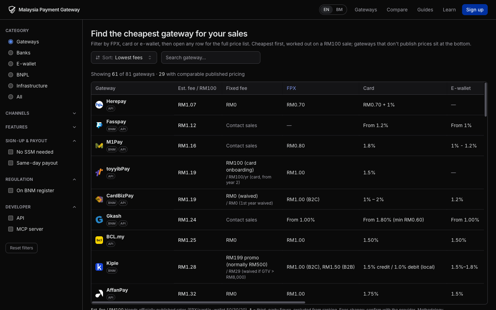

<p align="center">
  <a href="https://malaysiapg.com.my/">
    <picture>
      <source media="(prefers-color-scheme: dark)" srcset=".github/readme/logo-dark.svg">
      
    </picture>
  </a>
</p>

<h1 align="center">Malaysia Payment Gateway (MPG)</h1>

<p align="center">
  Compare the fees of every Malaysian payment gateway: FPX, cards, e-wallets, DuitNow QR and BNPL.<br>
  Every number comes from the provider's official pricing page.
</p>

<p align="center">
  <a href="https://malaysiapg.com.my/"></a>
  
  <a href="LICENSE"></a>
  <a href="LICENSE-DATA"></a>
</p>

<p align="center">
  <a href="https://malaysiapg.com.my/">
    
  </a>
</p>

## What you get

- **81 gateways** with fees taken from each provider's official pricing page, each with a source link and a `verified_date`
- **Ranked by real cost**: estimated fee on a RM100 sale, blending FPX, card and e-wallet 50/30/20. Gateways that don't publish comparable rates are listed as "on request", never guessed
- **Filters that matter to sellers**: channels, BNM register, API and MCP support, [sign-up without SSM](https://malaysiapg.com.my/best/payment-gateway-without-ssm/) and [same-day payout](https://malaysiapg.com.my/best/fastest-settlement/), each backed by a quote from the gateway's own page
- **English and Bahasa Malaysia** on every page
- **Free JSON API**: [`/api/gateways.json`](https://malaysiapg.com.my/api/gateways.json), plus `/api/gateways/<slug>.json` per gateway
- **MCP server for AI agents**: `https://mcp.malaysiapg.com.my/mcp` (source in [`mcp/`](mcp/))
- Guides for merchants and developers at [/learn](https://malaysiapg.com.my/learn/) and [/blog](https://malaysiapg.com.my/blog/)

<p align="center">
  <a href="https://malaysiapg.com.my/gateways/">
    
  </a>
</p>

## The one hard rule

**Fees are never made up.** Every figure comes from an official source URL stored next to it. If a provider does not publish a rate, the entry says `"Contact sales"` (negotiated or unpublished) or `"—"` (not offered). Third-party figures carry a trailing `*` and are left out of rankings. Fees change and are often negotiable by volume, so confirm with the provider before you sign.

## Stack

- [Astro 7](https://astro.build/) static output and Tailwind CSS v4. No server, no database
- Gateway data is one Markdown file per provider in [`src/content/gateways/`](src/content/gateways/), validated by Zod against [`src/content.config.ts`](src/content.config.ts)
- Auth for the contribute flow is Clerk via CDN, client-side only
- Deployed on Cloudflare Pages straight from `master`
- Standalone MCP server (Cloudflare Worker) in [`mcp/`](mcp/)

## Run it

```bash
npm install
npm run dev        # dev server
npm test           # vitest (fee parsing, ranking, content rules)
npx astro check    # types + content schema
npm run build      # static build (EN + BM pages)
npm run preview    # preview the built site
```

## Contributing

The most useful contribution: **spot a wrong fee and fix it with an official source.** See [CONTRIBUTING.md](CONTRIBUTING.md): fork, edit the gateway's `.md` file, open a PR. Adding a missing Malaysian gateway is one new file in `src/content/gateways/`, no code needed. The table row, detail page and API entry appear at build.

## Integrating a gateway?

The companion repo [afu-it/malaysia-payment-gateway](https://github.com/afu-it/malaysia-payment-gateway) has agent skills for 60+ Malaysian gateways, built from each one's official developer docs:

```bash
npx skills@latest add afu-it/malaysia-payment-gateway
```

## Licensing

| What | License |
|---|---|
| Source code | [MIT](LICENSE) |
| Gateway dataset (`src/content/gateways/`, JSON API) | [CC BY 4.0](LICENSE-DATA). Attribute "Malaysia Payment Gateway (malaysiapg.com.my)" |
| Provider logos (`src/assets/logos/`) | Trademarks of their owners, used for identification only |

## Author

Built by [Afu](https://github.com/afu-it) · [@afwzn on Threads](https://www.threads.net/@afwzn)
